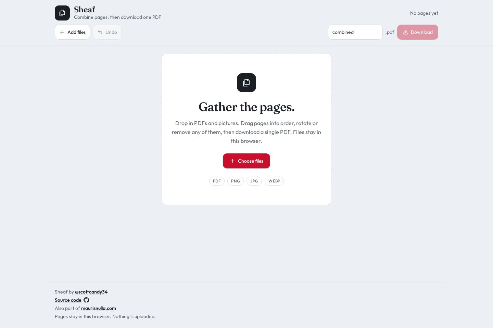
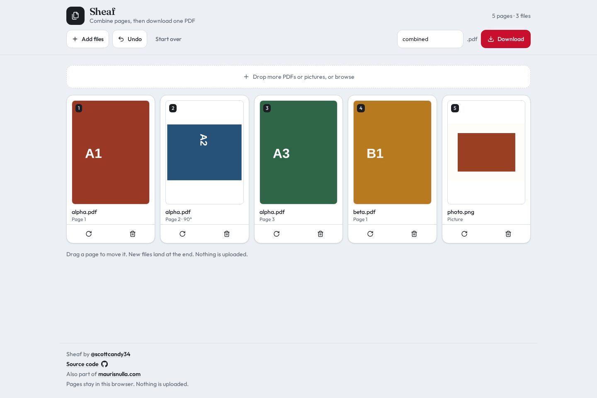
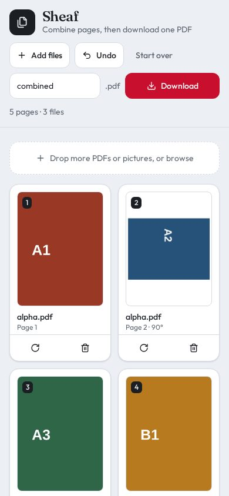

# Sheaf

Combine PDFs and pictures into one file. Put the pages in the order you want, drop the ones you do not, and download a new PDF. The files never leave the browser.



Sheaf is a page desk. You open it when you have a stack of documents that should have been one document, plus a photo or a scan that belongs in the middle. Drop the files on the page. Every page of every PDF becomes its own card. Every picture becomes a card too. The order of the cards is the order of the file you download.

There is no account and no upload. Reading a PDF, drawing the thumbnails, and building the finished file all happen on your machine. Close the tab and the pages are gone. That is the whole product: a combiner you can use on a contract, a lab packet, or a scan you would rather not send to someone else's server.

Sheaf is part of [maurisnulla.com](https://maurisnulla.com).

## The desk



A PDF is split into its pages. A picture is a single page. Files you add later land at the end, so a new document does not scramble an order you already set.

Drag a card to move that page. The card follows the pointer, and the other cards shift to make a gap. Rotate turns a page a quarter turn at a time. On a PDF page that turn is stored in the file. On a picture, the image is drawn into the page already turned, so it stays upright in viewers that ignore page rotation. Remove takes a page off the stack. The original file is still there, so Undo can put the page back.

Undo walks back through adds, moves, rotations, and deletions, forty steps deep. Start over clears the desk, and it asks before it does. The name next to Download is the name of the new file. It does not have to match any of the files you opened.

Download builds one PDF from the cards still on the desk, in the order shown, and saves it.



On a phone the cards sit in two columns. Dragging works with a finger. Rotate and remove stay on the card, so a drag does not start when you meant to tap a button.

## What you can add

PDF, PNG, JPG, and WEBP. Pick several at once, or drop them on the page, then add more later. One file can be up to 100 MB. A password-protected PDF is refused, with a note to remove the password first. A file that is not a PDF or a picture is skipped, and the page names it.

Pictures are placed on their own page and fitted so the long edge is a normal letter-page length. WebP and GIF are flattened to a format a PDF can hold before they are added. The result is an ordinary PDF: pages in your order, nothing else mixed in.

## What it will not do

Sheaf does not edit the words on a page, fill a form, sign anything, or read text out of a scan. It does not merge by chapter or by bookmark. It is a page stack. Keep a page, drop it, turn it, move it, then bind what is left.

## Run it locally

```bash
npm install
npm run dev
```

Open the local URL the dev server prints. `npm run build` makes the production build.

## Credit

Sheaf by [@scottcandy34](https://x.com/scottcandy34). The source is this repository. Also part of [maurisnulla.com](https://maurisnulla.com).
